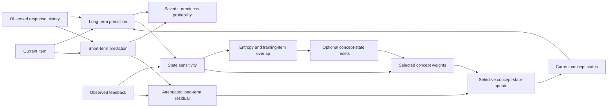

<div align="center">

# IASE-KT

### Multi-Concept Knowledge Tracing with Adaptive State Updates

**State-dependent feedback allocation · Prediction timescale separation · Adaptive computation**

`PyTorch 2.7.1` &nbsp; `Python 3.11–3.13` &nbsp; `Complete-response learning`

</div>

---

IASE-KT predicts item-level correctness from a learner's response history, the current item, and its complete knowledge-component (KC) set. After feedback is observed, the model assigns concept weights from their influence on the long-term predictor, attenuates the long-term correction using recent-response information, and updates only the concepts associated with the current item.

This repository provides the model, data preparation, joint objective, student-disjoint training, checkpoint assessment, and executable integrity checks. Every response contributes at most one scored prediction, regardless of its number of concepts.

## 🔬 Method

| Component | Computation | Role in the sequential model |
|:--|:--|:--|
| **RCA** — Relative Contribution Allocation | A likelihood gradient dotted with the displacement from the initial concept state | Estimate relative concept weights without repeated prediction |
| **PTS** — Prediction Timescale Separation | Add long- and short-term logits; scale the long-term residual by `exp(-abs(z_short) / T_r)` | Distinguish current prediction from persistent state correction |
| **IAW** — Importance-Aware Weighting | Combine base-weight entropy with training-item Jaccard relations | Select ambiguous multi-concept events for refinement and regulate update coefficients |
| **Selective refinement** | Reset one concept at a time; recompute attention and likelihood; apply a shared iterative map | Refine weights while holding the item, history, and other concept states fixed |



The prediction is saved before the current response enters either history or state updates. In EdNet, all items in a solving group receive predictions from the same pre-feedback snapshot; their feedback updates then follow item ID and original-row order.

## 📁 Repository

```text
IASE-KT/
├── config.py       # Validated model and experiment configurations
├── data.py         # Complete-response ingestion, splits, and sparse KC relations
├── model.py        # Causal encoder, RCA, PTS, IAW, and learner runtime state
├── losses.py       # Event-masked objectives and explicit parameter regularization
├── train.py        # Student-disjoint training and validation checkpoint selection
├── evaluate.py     # ROC AUC, accuracy, FC-AUC, and checkpoint assessment
├── validate.py     # Executable mathematical and protocol checks
├── requirements.txt
├── README.md
└── validation/     # Review records and final execution results
```

## ⚙️ Installation

The core dependencies are PyTorch and NumPy. SciPy supports the optional paired-seed comparison. The software was executed on Windows with Python 3.12 and PyTorch 2.7.1 CPU; CUDA execution remains a separate assessment.

```bash
python -m venv .venv
```

Activate the environment:

```powershell
# Windows PowerShell
.venv\Scripts\Activate.ps1
```

```bash
# Linux or macOS
source .venv/bin/activate
```

```bash
python -m pip install -r requirements.txt
python validate.py --report validation/local_checks.json
```

For a CUDA 12.8 installation, select the corresponding PyTorch wheel:

```bash
python -m pip install torch==2.7.1+cu128 --force-reinstall --no-deps --index-url https://download.pytorch.org/whl/cu128
```

## 🗂️ Data contract

Each canonical CSV row represents one complete response. IDs are nonnegative integers; student IDs and event IDs are preserved strings. `data.py canonical` remaps item and concept IDs to compact vocabularies and persists the original ID mapping.

| Column | Type | Meaning |
|:--|:--|:--|
| `student_id` | string | Learner identity, stripped of surrounding whitespace |
| `item_id` | integer | Item identifier |
| `concept_ids` | string | Full distinct KC set, separated by `|` |
| `outcome` | `0` or `1` | Observed item-level correctness |
| `position` | integer | Chronological response position or ordering timestamp |
| `event_id` | string | Unique response identifier within the learner |
| `group_id` | optional string | Atomic solving group; empty for independent responses |
| `original_row` | optional integer | Original source-row index used to resolve update order |

Rows with the same learner and event ID are merged only when their item, outcome, position, group, and original-row metadata agree. Their KC sets are combined. Distinct event IDs remain distinct even if the learner answers the same item repeatedly.

### Dataset sources

**XES3G5M**

```text
https://github.com/ai4ed/XES3G5M
```

**EdNet-KT1**

```text
https://github.com/riiid/ednet
```

**ASSISTments2009 Skill Builder**

```text
https://sites.google.com/site/assistmentsdata/home/2009-2010-assistment-data/skill-builder-data-2009-2010
https://github.com/arghosh/AKT
```

Dataset access and use remain subject to the respective source terms. The package contains no redistributed learner records.

### XES3G5M

The public release provides preprocessed sequence CSV files. Its official clarification states that unique interaction identifiers are absent, so the complete original event stream cannot be recovered reliably from those files. This repository therefore accepts a canonical event export retaining complete KC annotations and unique event IDs. It does not infer event identity from repeated item/timestamp pairs or silently reconstruct overlapping sequence fragments.

The following command applies the manuscript's student-count protocol when a complete 18,066-student event export is available:

```bash
python data.py canonical --input /path/to/xes_complete_events.csv \
  --output data/XES3G5M --dataset XES3G5M --counts 12646 1807 3613
```

### EdNet-KT1-50K

The native adapter reads one KT1 CSV file per learner and the official `questions.csv` metadata. It selects learners before parsing their response files, retains solving groups and original row indices, and derives correctness from `user_answer` and `correct_answer`.

```bash
python data.py ednet --input /path/to/KT1 \
  --questions /path/to/contents/questions.csv \
  --output data/EdNet-KT1-50K --dataset EdNet-KT1-50K \
  --sample-size 50000 --counts 35000 5000 10000
```

### ASSIST2009-SB

The native adapter reads a raw Skill Builder CSV containing `user_id`, `problem_id`, `skill_id`, `correct`, and `order_id`. It combines multi-KC rows belonging to the same response, orders events by `order_id` and original row, and retains independent repeated responses.

```bash
python data.py assist --input /path/to/skill_builder_data.csv \
  --output data/ASSIST2009-SB --dataset ASSIST2009-SB \
  --counts 2905 415 831
```

Published ASSIST versions differ in filtering and duplicate handling. The exact-count command requires the matching 4,151-student version. The adapter rejects mismatched counts rather than altering the corpus to force a match. Preprocessed AKT three-line sequences do not contain the raw event identifiers required by this adapter; use a canonical export if those identifiers were preserved during the original preprocessing.

Each preparation command writes `canonical.csv`, `vocab.json`, and `split.json`. SHA-256 ordering uses `IASEKT-v1|sample|dataset name|student ID` for sampling and the same expression with `split` for partitioning. Sampling precedes partitioning. All seeds use the same student partitions.

## 🚀 Training and assessment

```bash
python train.py --data data/EdNet-KT1-50K/canonical.csv \
  --dataset EdNet-KT1-50K --output runs/EdNet-KT1-50K \
  --seeds 2022 2023 2024 2025 2026
```

On compatible CUDA hardware, BF16 backbone execution can be selected explicitly:

```bash
python train.py --data data/EdNet-KT1-50K/canonical.csv \
  --dataset EdNet-KT1-50K --output runs/EdNet-KT1-50K \
  --device cuda --precision bfloat16
```

Saved logits, state vectors, attention statistics, attribution weights, entropy, and loss reductions use FP32. Master parameters remain FP32. Validation and checkpoint assessment inherit the stored backbone precision setting. Local sensitivity requires autograd during assessment; use `torch.no_grad()`, not `torch.inference_mode()`.

```bash
python evaluate.py --checkpoint runs/EdNet-KT1-50K/seed_2022/best.pt \
  --data data/EdNet-KT1-50K/canonical.csv --split test \
  --output runs/EdNet-KT1-50K/seed_2022/assessment.json
```

Use one-line commands in Windows PowerShell, or replace Bash continuation characters with PowerShell backticks.

### Experimental protocol

| Setting | Default |
|:--|--:|
| State / interaction dimension | 128 |
| Causal encoder layers / heads | 2 / 4 |
| Encoder feed-forward dimension | 512 |
| Dropout | 0.1 |
| First segment / later new events / retained history | 200 / 100 / 100 |
| Short-term window | 20 |
| Attribution / attenuation temperature | 0.7 / 1.0 |
| Refinement threshold / shared-map iterations | 0.55 / 2 |
| Entropy exponent | 1.0 |
| AdamW learning rate | 0.001 |
| Optimizer batch | 128 scored segments |
| Linear warm-up | First 5% of planned optimizer steps |
| Maximum epochs / early-stopping patience | 100 / 10 |
| Gradient norm cap | 1.0 |
| Separation / consistency / structure / L2 weight | 0.03 / 0.1 / 0.01 / 0.0001 |

Concept Jaccard statistics count distinct **training items**, never response frequencies or held-out items. They remain fixed during validation and testing. Vocabulary construction uses item/KC identifiers, while outcomes from held-out students never enter training losses or relation fitting.

The first response initializes the learner trajectory and is excluded from prediction losses and metrics. Its observed feedback updates state and history. Subsequent scored events are processed once. Overlapping history is carried as context without repeating its feedback updates. Atomic solving groups remain intact at segment boundaries and may exceed the nominal segment length. The public stateful API rejects reopening an already processed group, replaying observed event IDs, or moving backward in time across calls, before applying additional feedback.

The prediction, separation, and structure losses are normalized over valid events in the complete optimizer batch. The centered-logit separation statistic spans that same batch. No independent microbatch approximation is substituted. This exact reduction retains segment graphs and can require substantial memory at the default batch size; `--batch-size` is an explicit experimental control. Initialization-only segments do not occupy scored-batch slots or create L2-only optimization steps.

The objective includes explicit `lambda_l2 * sum(parameter**2)`. AdamW therefore uses `weight_decay=0`; the manuscript does not specify a numerical value for an additional decoupled penalty. Warm-up is followed by a constant learning rate. The best checkpoint is selected solely by validation AUC. Test assessment follows checkpoint restoration, and a SHA-256 corpus digest guards checkpoint/data consistency.

### Branch controls

```bash
python train.py --data data/EdNet-KT1-50K/canonical.csv \
  --dataset EdNet-KT1-50K --output runs/base \
  --branch-mode base_only --seeds 2022

python train.py --data data/EdNet-KT1-50K/canonical.csv \
  --dataset EdNet-KT1-50K --output runs/refinement \
  --branch-mode refine_only --seeds 2022
```

`adaptive` applies the entropy/co-occurrence trigger. `base_only` retains sensitivity weights. `refine_only` refines every multi-concept response; single-concept responses always retain the base branch.

## 📐 Implementation contract

The following conventions specify details not fixed by the manuscript equations:

- Learned position embeddings index the retained history locally from zero; positions are reassigned when the context window changes.
- The causal encoder uses post-normalized attention blocks and reads the last history token. Explicit attention matrix operations support higher-order derivatives.
- The prediction hidden width and the default refinement hidden width equal the state dimension. `refinement_dim` remains configurable.
- Each concept's initial reset anchor is cached at its first encounter in a learner trajectory. States and anchors are detached at segment boundaries.
- The first response updates state and history but does not contribute prediction loss. The manuscript excludes this response from evaluation; its training initialization is not fully specified.
- `differentiate_sensitivity=True` allows training losses to differentiate through the likelihood gradient. Setting it to `False` stops the gradient-of-gradient path while retaining the state-displacement path.
- The zero entropy-factor boundary uses a finite zero derivative for positive exponents; exponent zero has unit scale. This preserves finite gradients for fractional exponents.
- Ordinary responses reuse their saved prediction tensors for feedback calculations. Solving groups recompute update quantities after label revelation, while prediction and separation losses use the saved pre-feedback logits.
- Tensor dimensions and vocabulary sizes determine the actual parameter count. No unused parameters are added to force agreement with a reported total.

These conventions are part of the executable experimental configuration. Changing them requires a new benchmark run and should be reported with that run's settings.

## ✅ Validation and outputs

`validate.py` checks independent numerical loss calculations, likelihood sensitivity against finite differences, prediction causality, learner isolation, bundle timing and ordering, state-update scope, entropy boundaries, CPU BF16, deterministic partitions, checkpoint restoration, and independent pairwise ROC AUC calculations.

The three review cycles and their repairs are recorded in `validation/review.json`. The final check inventory and runtime are recorded in `validation/final_checks.json`. Checks use deterministic fixture inputs to assess executable behavior. They do not constitute cross-dataset performance reproduction, k-fold validation, or a measurement of the manuscript's GPU deployment costs.

Each training seed writes:

```text
seed_2022/
├── best.pt       # Parameters, optimizer state, configuration, splits, and relations
├── history.json  # Epoch losses and validation measurements
└── result.json   # Assessment of the selected checkpoint
```

`summary.json` aggregates seed results using sample standard deviations. ROC AUC is `null` when only one outcome class is present; validation checkpoint selection requires both classes. FC-AUC matches each multi-KC event/concept pair to the first subsequent single-KC response containing that concept within 20 valid interactions. Those matched pairs retain the multiplicity specified by the event/concept protocol.

### Benchmark evaluation status

The release has executable software and protocol validation. Full XES3G5M, EdNet-KT1-50K, and ASSIST2009-SB training, the manuscript's AUC values, and CUDA latency/MAC measurements have not been reproduced in this release. No fixture score is presented as a dataset benchmark result.

---

<div align="center">
<sub>Complete responses · Student-disjoint assessment · Explicit experimental settings</sub>
</div>
